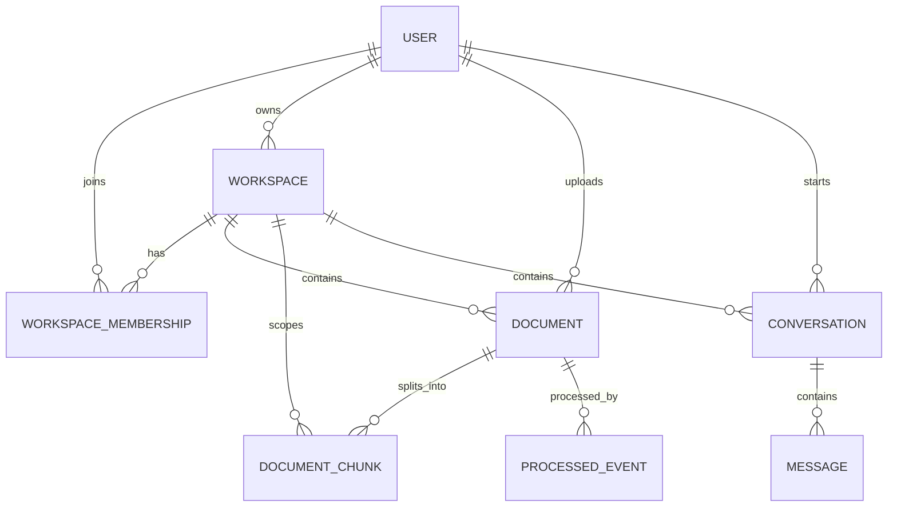

# Data Model and Persistence Design

## 1. Main entities

The current ORM source defines these principal records:

| Entity | Purpose | Important attributes |
|---|---|---|
| User | Login identity | id, email, password_hash, active state |
| Workspace | Tenant-like knowledge boundary | id, name, slug, owner_id |
| WorkspaceMembership | User access and role in workspace | workspace_id, user_id, role |
| Document | Uploaded source metadata | id, workspace_id, uploaded_by, filename, storage_key, content_type, size, SHA-256, status, page_count, chunk_count |
| DocumentChunk | Extracted searchable passage | id, document_id, workspace_id, chunk_index, page_number, content, vector(384) |
| Conversation | Chat session | id, workspace_id, user_id, title |
| Message | Conversation turn | conversation_id, role, content, citation JSON |
| OutboxEvent | Durable event intent | event_id, topic, aggregate_id, payload, published_at, attempts, last_error |
| ProcessedEvent | Worker deduplication marker | event_id, document_id, processed_at |
| RefreshToken | Refresh-token revocation/expiry state | token identifier, user, expiry and revoked timestamp |

Consult the SQLAlchemy models and Alembic migrations for exact column types, constraints and migration history.

## 2. Relationship view

## 3. Workspace isolation

Workspace membership is checked before workspace-scoped document and chat operations. Document and chunk records carry workspace IDs. Retrieval filters chunks by the requested workspace and joins only ready documents.

This is application-level tenant isolation. A future hardening step may add PostgreSQL row-level security, subject to careful migration and connection-context design.

## 4. Storage

- Relational metadata and chunk text/vector records are stored in PostgreSQL.
- Original uploaded files are stored under a workspace-specific directory using a server-generated storage key.
- Docker Compose mounts a persistent document volume into API and worker containers.
- A cloud deployment should move originals to private S3 buckets and persist only object keys/metadata in PostgreSQL.

## 5. Indexing and integrity considerations

Review actual migrations before changing indexes. Important query patterns include:
- Membership lookup by workspace and user.
- Documents by workspace and creation time.
- Chunks by workspace/document.
- Conversations by workspace/user and creation time.
- Processed-event lookup by event ID.
- Outbox lookup for unpublished events.

The current chunk embedding column is a 384-dimensional pgvector vector. Any embedding model/dimension change requires a coordinated migration and re-index plan; do not mix incompatible vector dimensions.
