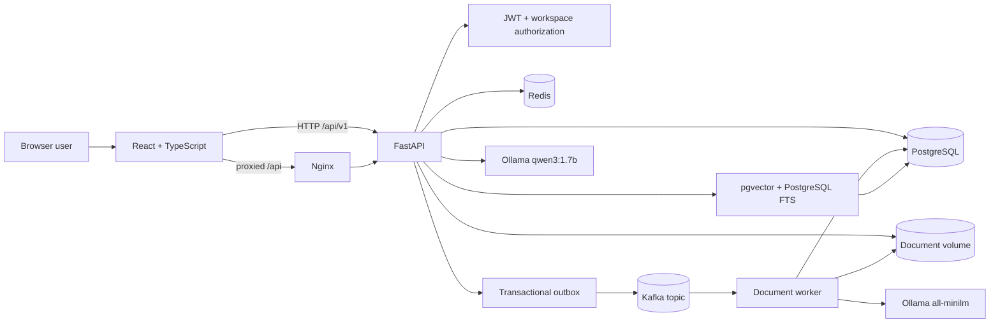

# High-Level Design (HLD)

## 1. Purpose

DocuMind AI is a workspace-scoped document intelligence application. A user uploads supported files, the system extracts and indexes their content, and a user asks natural-language questions answered from retrieved passages with citation metadata.

## 2. Goals and non-goals

### Goals
- Authenticated users and workspace membership boundaries.
- PDF and UTF-8 TXT ingestion.
- Background ingestion using an outbox and Kafka worker.
- Semantic and lexical retrieval over indexed chunks.
- Grounded answer generation with source citations.
- Persistent document metadata and conversation history.
- Local containerized development with local Ollama inference.

### Current non-goals / limitations
- OCR for image-only/scanned PDFs.
- DOCX, spreadsheets, images or arbitrary file types.
- A deployed public cloud environment.
- Multi-region/high-availability infrastructure.
- A multi-broker Kafka cluster in the local Compose configuration.

## 3. Context and logical architecture

The browser talks to the Nginx-served frontend. Nginx serves the React build and proxies `/api/` to the backend. The backend persists relational data and the original file, emits an outbox event, and serves chat/retrieval requests. The separate worker consumes ingestion events and writes chunk/vector records.

## 4. Runtime deployment view

The current Compose topology defines six containers:

| Service | Container name | Responsibility |
|---|---|---|
| frontend | document-intelligence-frontend | Nginx + built React application |
| backend | document-intelligence-backend | FastAPI REST API |
| postgres | document-intelligence-db | PostgreSQL 17 with pgvector image |
| redis | documind-redis | Cache/rate-limit/metrics support |
| kafka | documind-kafka | Event broker |
| document-worker | documind-document-worker | Outbox dispatch and ingestion consumer |

Persistent Compose volumes are defined for PostgreSQL data, document files, Kafka data and Redis data. Do not use `docker compose down -v` for routine troubleshooting.

In the local Windows setup, Ollama runs outside Docker on the host and is addressed from containers via `host.docker.internal:11434`.

## 5. Key data flows

### Upload and ingestion
1. Browser submits multipart PDF/TXT upload to the workspace document endpoint.
2. API validates membership, role, MIME type, extension, size and basic file validity.
3. API writes the original file to workspace-scoped storage.
4. In one DB transaction, API writes the document row and an outbox event.
5. Outbox dispatcher publishes to `documind.document.ingest`.
6. Worker validates and deduplicates the event, extracts text, chunks it, obtains embeddings and persists chunks.
7. Worker marks the document ready after successful DB transaction; terminal processing failures are marked failed and sent to the DLQ.

### Question answering
1. API verifies workspace membership and persists/loads conversation.
2. Question is embedded.
3. Backend runs pgvector cosine-distance candidate retrieval and PostgreSQL full-text candidate retrieval.
4. Candidate ranks are fused using 0.75 semantic + 0.25 keyword score; duplicates are suppressed and low scores filtered.
5. Up to five selected passages are sent to the configured chat model.
6. API returns answer and citation metadata and persists messages.

## 6. Trust boundaries and security

- Browser is untrusted.
- API authenticates using bearer access tokens and checks workspace membership on workspace-scoped operations.
- Uploaded files and extracted document excerpts are untrusted input.
- The answer-generation system prompt explicitly says excerpts are data, not instructions.
- Database and broker are private Compose-network services in local deployment.
- Secrets belong in environment configuration or a cloud secret manager, never Git.
- Production deployment must use HTTPS, restricted ingress, strong secrets, least-privilege IAM and backups.

## 7. Architectural decisions

| Decision | Rationale | Trade-off |
|---|---|---|
| PostgreSQL | Relational transactions and durable application records | Relational DB is a central dependency |
| pgvector | Keep vector records alongside document metadata | Vector scaling shares DB resources |
| Hybrid retrieval | Combines semantic and lexical signals | Requires score tuning and evaluation |
| Kafka + worker | Decouples expensive ingestion from HTTP request | More services and operational complexity |
| Transactional outbox | DB state and event intent commit atomically | Requires dispatcher and event lifecycle management |
| Redis | Fast cache and shared operational state | Additional dependency; cache invalidation matters |
| Ollama locally | No per-token hosted inference charge for local demo | Host resource limits and model latency |

## 8. Scaling path (target design, not current deployment)

- API: multiple stateless replicas behind an HTTPS load balancer.
- Worker: scale consumers by partition count and measured processing throughput.
- PostgreSQL: managed PostgreSQL, backups, connection pooling, query/index monitoring; evaluate vector index strategy against measured corpus size.
- Kafka: multi-broker managed or self-managed cluster for availability; partition count and replication configured for workload.
- Redis: managed cache with authentication/TLS and availability configuration.
- Files: object storage such as S3 with lifecycle and encryption; database stores object key and metadata.
- AI inference: separately scaled model-serving tier or managed model endpoint, with timeouts, quotas and cost controls.

These are future architecture options. They are not statements that the project currently runs on AWS.
